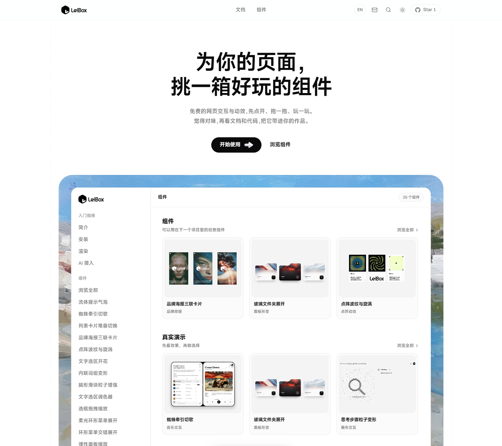
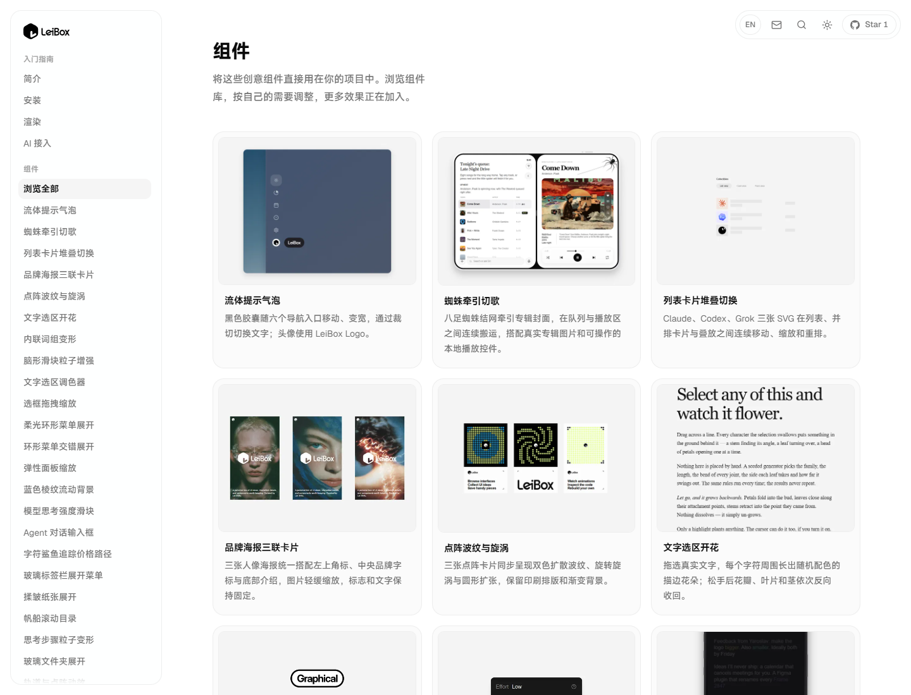
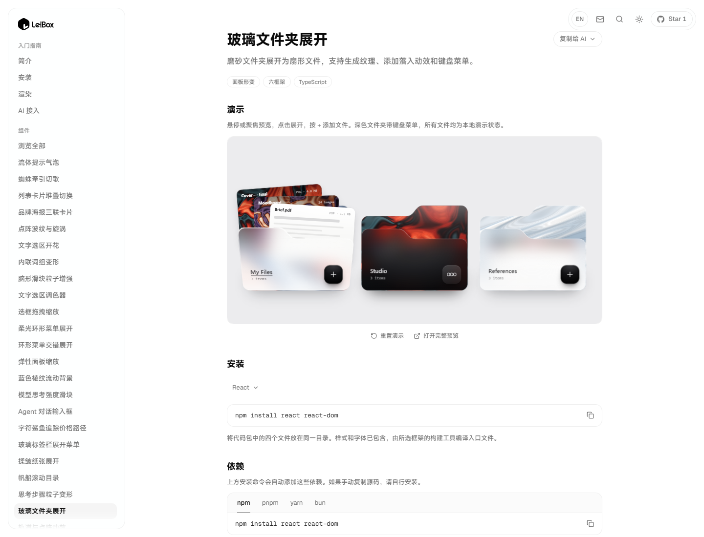
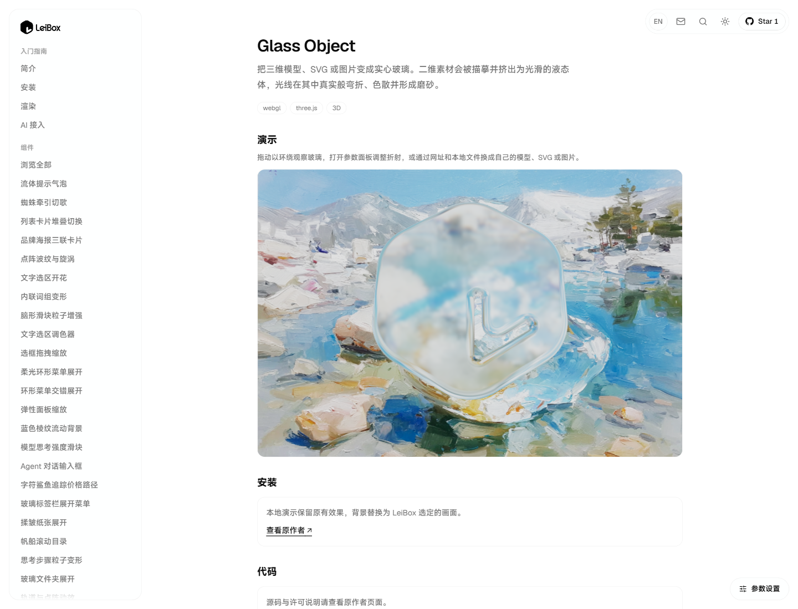

# LeiBox

**为你的页面，挑一箱好玩的组件。**

免费的网页交互与动效，先点开、拖一拖、玩一玩。\
觉得对味，再看文档和代码，把它带进你的作品。

LeiBox 是雷师傅维护的网页组件与交互灵感收藏。支持中英双语浏览，提供可操作的真实演示、组件文档、来源记录，以及按需读取的 AI 检索入口。

> **仅供学习使用。** 第三方设计、代码、图片、字体、商标等权利归各自权利人所有。本声明不代替授权，也不授予复制、分发或商业使用第三方内容的权利。

[在线网站](https://leibox-ui.netlify.app/) · [浏览组件](https://leibox-ui.netlify.app/components) · [使用说明](https://leibox-ui.netlify.app/copyright)

## 当前项目截图

以下图片在重新构建当前本地工作树后直接截取，采集日期为 **2026-10-28**。来源、实际交互状态和视口信息见 [截图记录](docs/screenshots/README.md)。它们包含尚未提交的本地修改，不代表线上部署已同步；图片未经拼接或生成。

### 首页

### 组件浏览

### 玻璃文件夹交互

### 玻璃物体与自定义背景

## 可以做什么

- 浏览界面学习与交互实验，体验实际可用的状态。
- 按组件页面查看支持的框架、依赖、设计参考和代码来源。
- 通过 LeiBox Skill 检索示例、选择框架并读取本站实际提供的代码包。
- 在复用前核对原始许可；许可不清楚的素材或设计，应取得授权或换成权利清楚的替代内容。

## AI 检索

~~~sh
npx skills add https://leibox-ui.netlify.app --skill leibox
~~~

详见 [AI 接入指南](docs/AI-INTEGRATION.md) 与 [Skill](integrations/skills/leibox/SKILL.md)。索引以实际生成的条目为准，不承诺未提供的组件或能力。

## 本地运行

推荐 Node.js 24。

~~~sh
git clone https://github.com/leishifu666/LeiBox.git
cd LeiBox
npm ci
npm run build
npm start
~~~

打开 [本地网站](http://127.0.0.1:3000/)。项目使用 Next.js 静态导出，开发时使用 npm run dev。

## 来源、许可与权利人联系

本项目不是所参考作者或项目的官方网站，不代表其授权或背书。修改代码写法、替换背景、免费公开或注明学习用途，均不自动消除已有代码与素材的许可要求。

9 个原有效果已在本地恢复，演示背景替换为维护者选定的雪山湖泊画面。它们保留原实现与来源，不声称独立原创；源码取用入口指向原作者。现有代码适用的版权及许可声明保留在 [LICENSE.md](LICENSE.md)。具体范围见 [来源与使用说明](COPYRIGHT.md)。

如您是相关权利人，请发邮件至 leir0491@gmail.com，附涉及页面、原始作品或权利证明、具体问题及联系方式。核实后会按情况更正署名、替换素材或移除内容。
