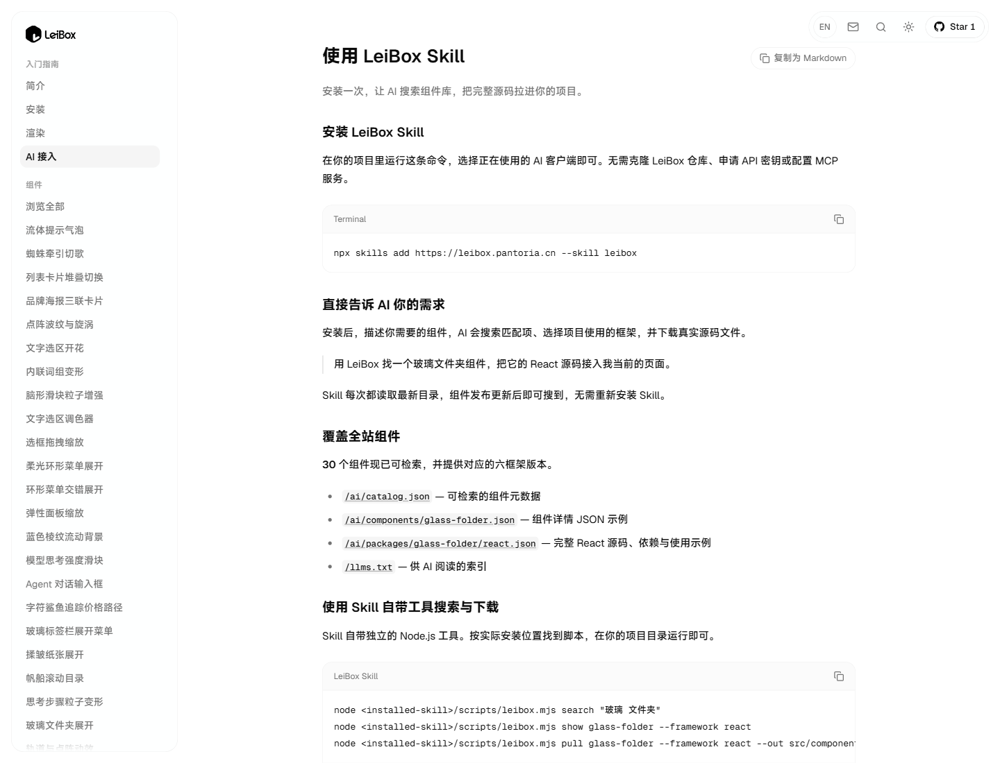

# LeiBox

**为你的页面，挑一箱好玩的组件。**

免费的网页交互与动效，先点开、拖一拖、玩一玩。\
觉得对味，再看文档和代码，把它带进你的作品。

LeiBox 是雷师傅维护的网页组件、交互与动效收藏。先在页面里体验真实效果，再查看文档、依赖和源码；也可以让 AI 按当前任务搜索合适的组件，把所选框架的代码包接入项目。

本站组件代码包提供 **React、Vue、Svelte、Solid、Preact 和 Vanilla** 版本，各组件支持情况以详情页为准。网站支持中英双语、明暗主题、响应式浏览和站内搜索。

> **仅供学习使用。** 第三方设计、代码、图片、字体、商标等权利归各自权利人所有。本声明不代替授权，也不授予复制、分发或商业使用第三方内容的权利。

[在线网站](https://leibox.pantoria.cn/) · [浏览组件](https://leibox.pantoria.cn/components) · [AI 接入](https://leibox.pantoria.cn/docs/mcp) · [使用说明](https://leibox.pantoria.cn/copyright)

## 当前项目截图

以下图片采集于 **2026-10-29**，来自当前本地生产构建。页面、交互状态和构建信息见 [截图记录](docs/screenshots/README.md)。

### 首页

### 组件浏览 · 无边框卡片

### 玻璃文件夹交互

### 玻璃物体与自定义背景

### AI 接入

## 可以做什么

- 体验真实交互：浏览导航、卡片、表单、分享、AI 输入和加载反馈等示例。
- 按框架取用：查看组件的用法、依赖、设计参考与代码来源，再选择项目需要的版本。
- 让 AI 按需查找：用中英文需求搜索、比较推荐结果，并下载所选框架的完整源码文件。
- 在复用前核对原始许可；许可不清楚的素材或设计，应取得授权或换成权利清楚的替代内容。

## AI 检索

~~~sh
npx skills add https://leibox.pantoria.cn --skill leibox
~~~

安装后，直接告诉 AI：

> 用 LeiBox 找一个适合团队成员邀请的组件，按我项目的框架接入完整源码。

详见 [AI 接入指南](docs/AI-INTEGRATION.md) 与 [Skill](integrations/skills/leibox/SKILL.md)。索引以实际生成的条目为准，不承诺未提供的组件或能力。

## 本地运行

推荐 Node.js 24。

~~~sh
git clone https://github.com/leishifu666/LeiBox.git
cd LeiBox
npm ci
npm run build
npm start
~~~

打开 [本地网站](http://127.0.0.1:3000/)。项目使用 Next.js 静态导出，开发时使用 npm run dev。

## 来源、许可与权利人联系

本项目不是所参考作者或项目的官方网站，不代表其授权或背书。修改代码写法、替换背景、免费公开或注明学习用途，均不自动消除已有代码与素材的许可要求。

组件的设计参考、实现来源和取用方式以详情页为准。原作者的实现与素材保留其来源，不声称独立原创。现有代码适用的版权及许可声明保留在 [LICENSE.md](LICENSE.md)，具体范围见 [来源与使用说明](COPYRIGHT.md)。

如您是相关权利人，请发邮件至 leir0491@gmail.com，附涉及页面、原始作品或权利证明、具体问题及联系方式。核实后会按情况更正署名、替换素材或移除内容。
