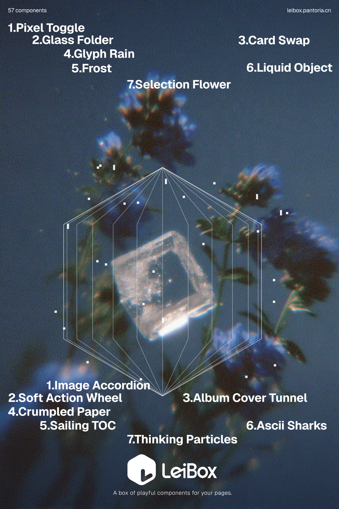
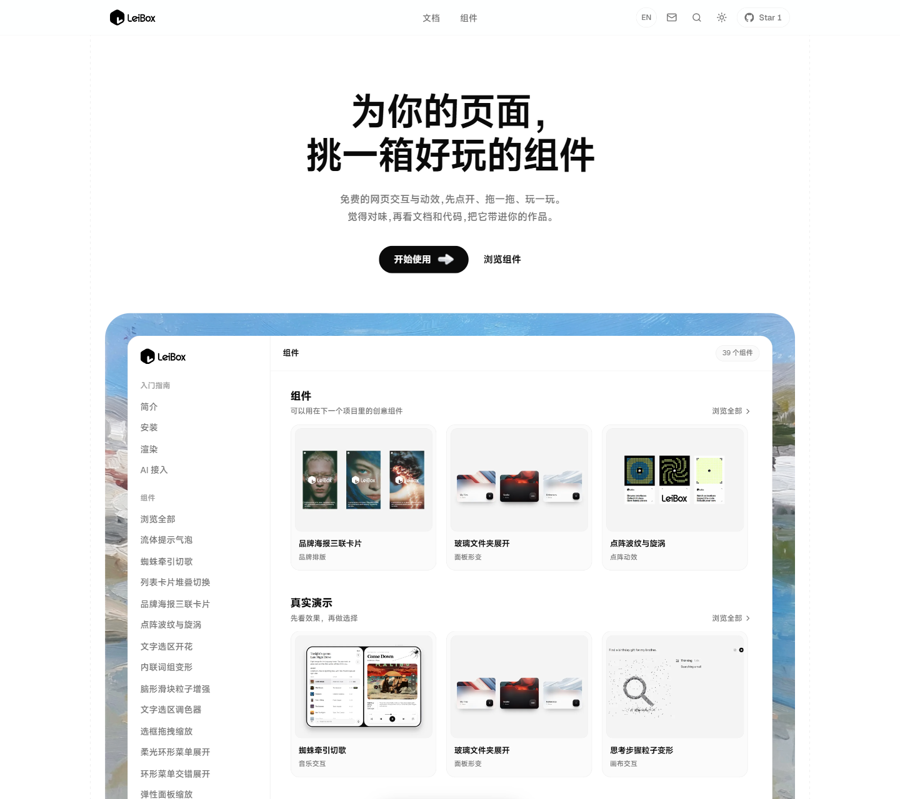
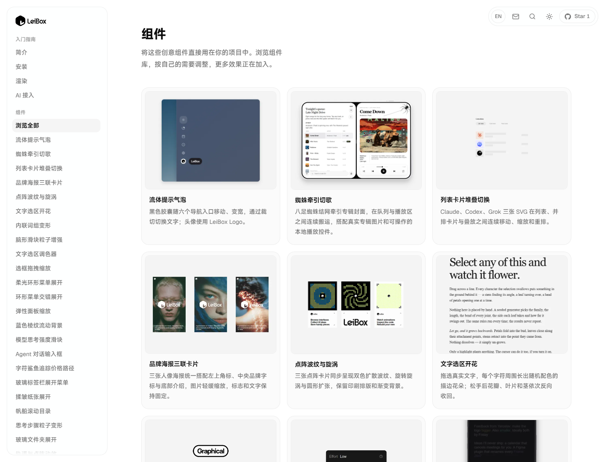
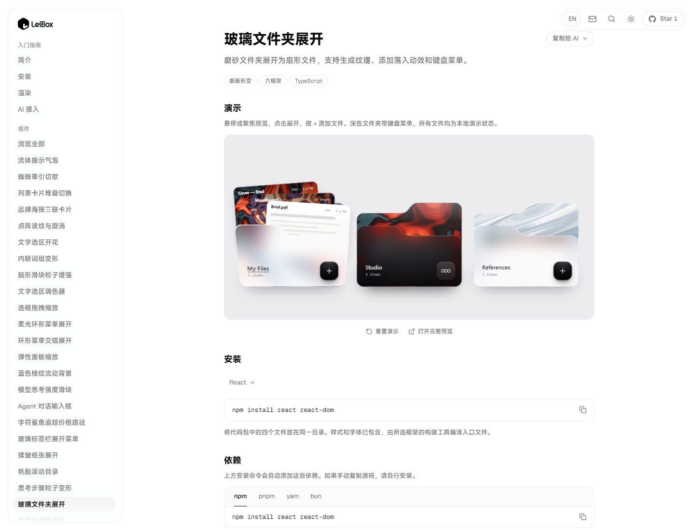
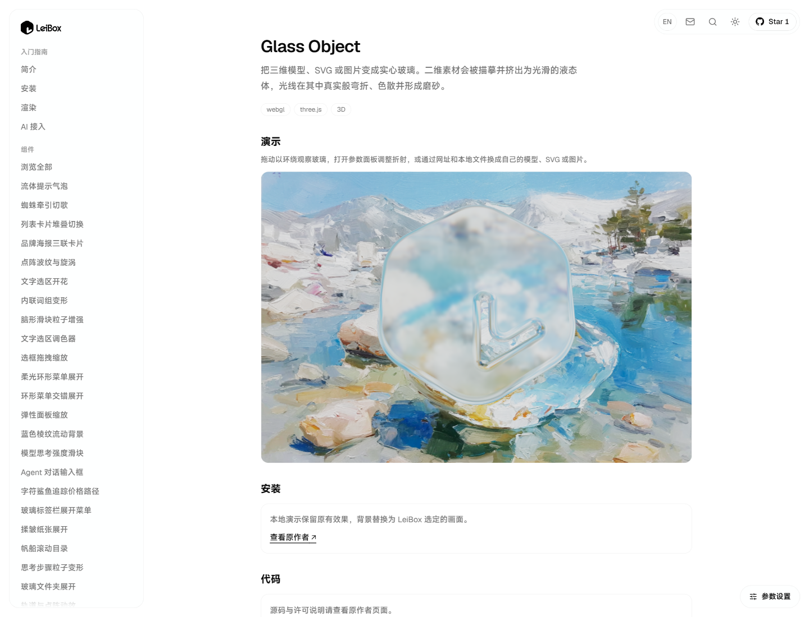
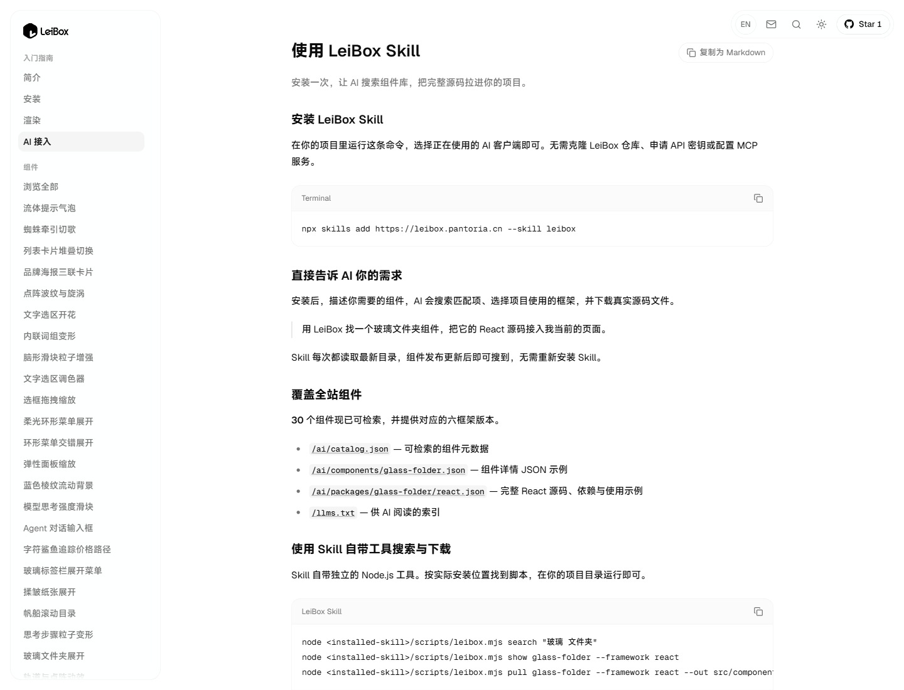

  

# LeiBox

**为你的页面，挑一箱好玩的组件。**

用 AI 搭网页很快，但页面里“这里该怎么动、点下去给什么反馈”往往最难调。LeiBox 是雷师傅维护的免费开源网页交互与动效库：平时在 X 等地方看到有意思的交互会自己复现整理，也会放一些自己做的效果进去。

你可以在网站上先点开试玩，觉得对味再拿代码和依赖说明；也可以装上配套的 Skill，让 AI 写页面时自动过来挑组件、接进你的项目里。

[在线网站](https://leibox.pantoria.cn/) · [浏览组件](https://leibox.pantoria.cn/components) · [AI 接入说明](https://leibox.pantoria.cn/docs/mcp) · [版权与来源](https://leibox.pantoria.cn/copyright)

## 怎么用

1. **先试玩再决定**：去 [组件列表](https://leibox.pantoria.cn/components) 点一点、拖一拖，看看实际手感和动态效果。
2. **按项目取代码**：每个组件详情页都写了用法、依赖和设计来源，按需要复制或下载对应框架的代码（覆盖 React、Vue、Svelte、Solid、Preact 和原生 JS，具体支持情况以详情页为准）。
3. **交给 AI 自动找**：装好 Skill 后，不用记住组件名字，写网页时直接告诉 AI 你想要什么效果，它会自己来搜并接入。

## 让 AI 自动搜索接入

在支持 Skill 的 AI 编程工具里，运行下面这行命令即可安装：

~~~sh
npx skills add https://leibox.pantoria.cn --skill leibox
~~~

装好之后，直接提需求就行，比如：

> 给图片生成过程加一个等待反馈，用项目现有的 React 接入。

AI 会先看你的项目用什么框架，再去 LeiBox 挑 1 到 3 个合适的组件给你选，确认后拉取完整代码写入项目。更多细节见 [AI 接入指南](docs/AI-INTEGRATION.md) 和 [Skill 说明](integrations/skills/leibox/SKILL.md)。

## 页面预览

查看更多页面截图（组件列表、组件详情、AI 接入）

| 组件列表 | 玻璃文件夹交互 |
| --- | --- |
|  |  |

| 玻璃物体（3D 材质效果） | AI 接入入口 |
| --- | --- |
|  |  |

## 本地运行

需要 Node.js 22 及以上版本（推荐 Node.js 24）：

~~~sh
git clone https://github.com/leishifu666/LeiBox.git
cd LeiBox
npm ci
npm run build
npm start
~~~

启动后访问 [http://127.0.0.1:3000/](http://127.0.0.1:3000/)。如果只是本地改代码预览，直接运行 `npm run dev`。

## 来源与版权说明

- **部分原创，部分复现**：库里的组件有雷师傅自己做的，也有参考自 X 等平台公开设计后重新实现的；网站早期基础代码包含改编自 [Canvas UI](https://github.com/DavidHDev/canvas-ui) 的部分。
- **复用前看清许可**：每个组件详情页都标了设计参考、代码来源和适用协议。代码开源不代表里面的参考设计、照片、专辑封面或品牌素材也自带商用授权；用于正式或商业项目前，请先核对对应说明或换成自己的素材。
- **联系维护者**：本项目仅供学习交流与设计参考，不代表任何原作者或品牌的官方立场。完整许可条款见 [LICENSE.md](LICENSE.md) 与 [COPYRIGHT.md](COPYRIGHT.md)。如有署名遗漏或版权处理需要，请发邮件至 `leir0491@gmail.com`（附涉及页面和说明），核实后会及时修正或移除。
