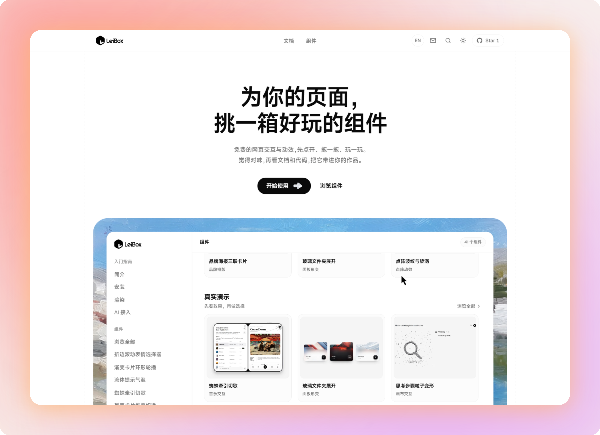
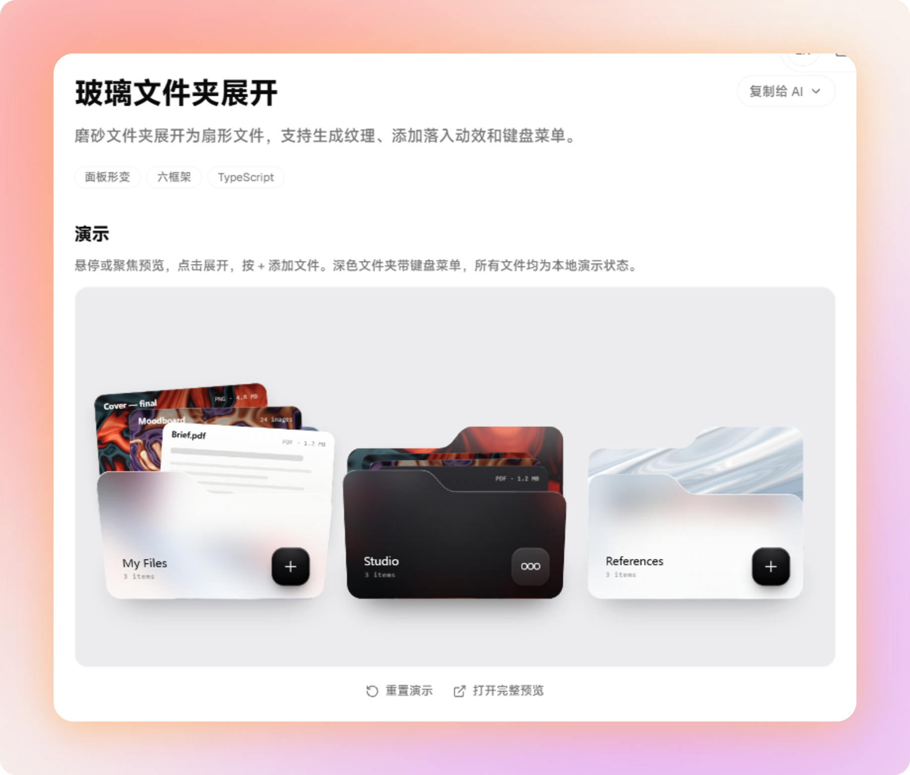
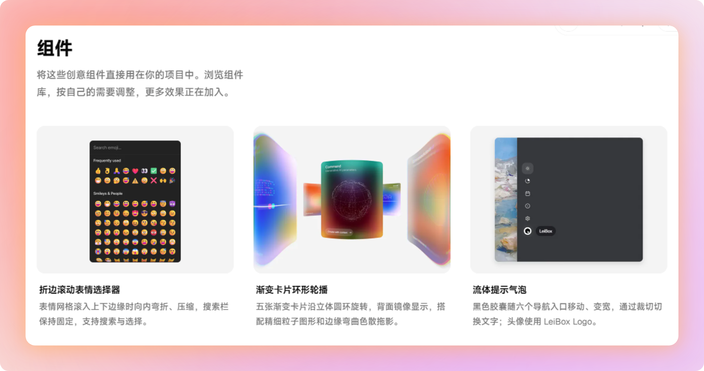
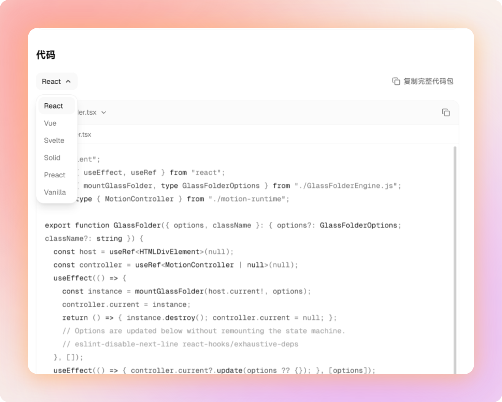
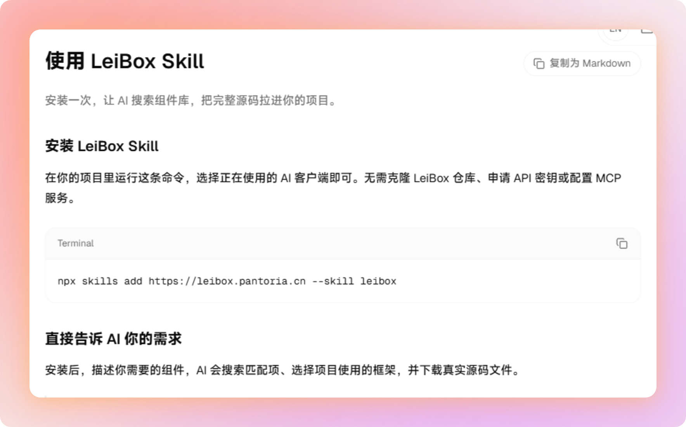

# 给 AI 做的网页，减点 AI 味，加点设计感

<video controls playsinline preload="metadata" poster="assets/video-poster.jpg" style="display:block;width:100%;height:auto;background:#080808;" aria-label="LeiBox 宣传片"><source src="video/leibox_v4_2_zh.mp4" type="video/mp4">你的浏览器暂不支持视频播放，请打开 video/leibox_v4_2_zh.mp4。</video>

*先看这支短片，感受一下 LeiBox 里的交互。*

大家好，我是雷师傅。

如果你也在用 AI 帮自己写网页，可能会碰到这样的时刻：功能已经跑通了，页面也有模有样，可多看两眼，总觉得少了点什么。

导航、卡片、按钮该有的都有。只是一换标题和图片，好像又能变成另一个项目。

想让 AI 把页面改得“高级一点”“有设计感一点”，却又很难用语言说明白究竟该改哪里。

我更倾向于换一种做法：**先找一个真正打动你的交互细节，再把它放进自己的网页里。**

一个有反馈的按钮，一次舒服的折叠展开，一处跟随鼠标变化的导航。东西不一定要多，只要能看出是你挑过的，页面的感觉就会不一样。

这也是我想把 **LeiBox** 分享给你的原因。

*为你的页面，挑一箱好玩的组件。*

## 先玩一下，再决定要不要用

LeiBox 是我维护的一个网页组件、交互与动效收藏箱。

其中一些是我从 X 上收集的优秀组件设计案例，都是我自己比较喜欢的。把它们整理在这里，是希望提供一个可以直观体验的空间。

你可以在里面点一点、悬停、拖拽或是滚动，先体验真实的效果，再判断它适不适合自己的页面。

比如这个“玻璃文件夹展开”。鼠标放上去可以预览，点击之后，文件会展开成一叠扇形卡片。

*点击展开后的文件夹。质感之外，展开的过程也值得亲自试一试。*

如果你正在做作品集或者资料展示页，可以看看这样的交互，能不能让一组内容更有意思。

再比如“流体提示气泡”：黑色胶囊会跟着六个导航入口移动，随着文字改变宽度。还有“折边滚动表情选择器”，表情网格滚到上下边缘时，会向内弯折、压缩。

*从表情选择到导航反馈，可以按当前页面的实际需要挑。*

这些细节适合放在哪里，比“这个效果够不够炫”更值得想。

作品展示需要一点个性，可以试试卡片的展开与切换；侧栏导航需要更清楚的反馈，可以看看提示气泡。页面原本已经很热闹，就少加一点。挑一个最适合当前网页的效果带走，不用把整箱动效都搬回去。

## 别只跟 AI 说「再高级一点」

用 AI 做网页时，难说清楚的往往就是那个“感觉”。如果只给一句“帮我加点动效”，你和 AI 对这句话的理解可能完全不同。

所以，LeiBox 除了能看能玩，也把需要的参考材料放在了组件详情里：使用说明、依赖、源码、使用示例，还有复刻提示词。

你喜欢哪一个，就打开它的详情。想直接接入，可以看源码；想继续调整，也可以把提示词交给 AI。

*先选项目使用的框架，再查看对应源码。*

代码包有 React、Vue、Svelte、Solid、Preact、Vanilla 等版本，具体支持情况以每个组件的详情为准。

这时候，你的需求就能说得更具体：

> 我想在作品集的资料区域使用这个玻璃文件夹效果。请按我项目的框架接入源码，保留现有的布局和配色，检查依赖，并验证展开、收起和手机上的显示。

从“给我一点设计感”，到“我选中了这个效果，想把它用在这里”，需求就清楚多了。接入项目后，内容、尺寸、样式和交互仍然需要继续适配。你可以改掉演示里的文字和图片，让它成为自己页面的一部分。

## 也可以让 AI 来找组件

如果你已经习惯在 AI 编程工具里工作，LeiBox 还提供了 **Skill / AI 接入入口**。

按页面说明安装 Skill 后，你可以让 AI 按需求查找组件，读取选定组件的用法，再获取项目框架的源码。

*在网站的「AI 接入」里查看安装和使用说明。*

你可以直接告诉它：

> 用 LeiBox 找一个适合我这个页面的导航交互，先说明推荐理由和使用限制，再按项目框架接入。

有明确喜欢的效果，就指定它；还没想好，就从当前页面要解决的问题出发，让 AI 帮你找候选。

建议在接入前，自己也点开玩一下。动画怎么开始、怎么结束，操作起来顺不顺，这些感受比一张静态图有用。

**AI 可以继续帮你写代码，你来选择适合页面的效果。**

如果你手上刚好有一个“已经能用，但还想再好看一点”的网页，欢迎来逛逛：

**LeiBox · leibox.pantoria.cn**

[打开 LeiBox，挑一个效果试试](https://leibox.pantoria.cn/)

网站可以免费浏览。具体组件和第三方素材的使用，请查看对应的来源与许可说明。

这次不妨先挑一个小地方改一改。

网页已经做出来了，再给它加点你的审美。
